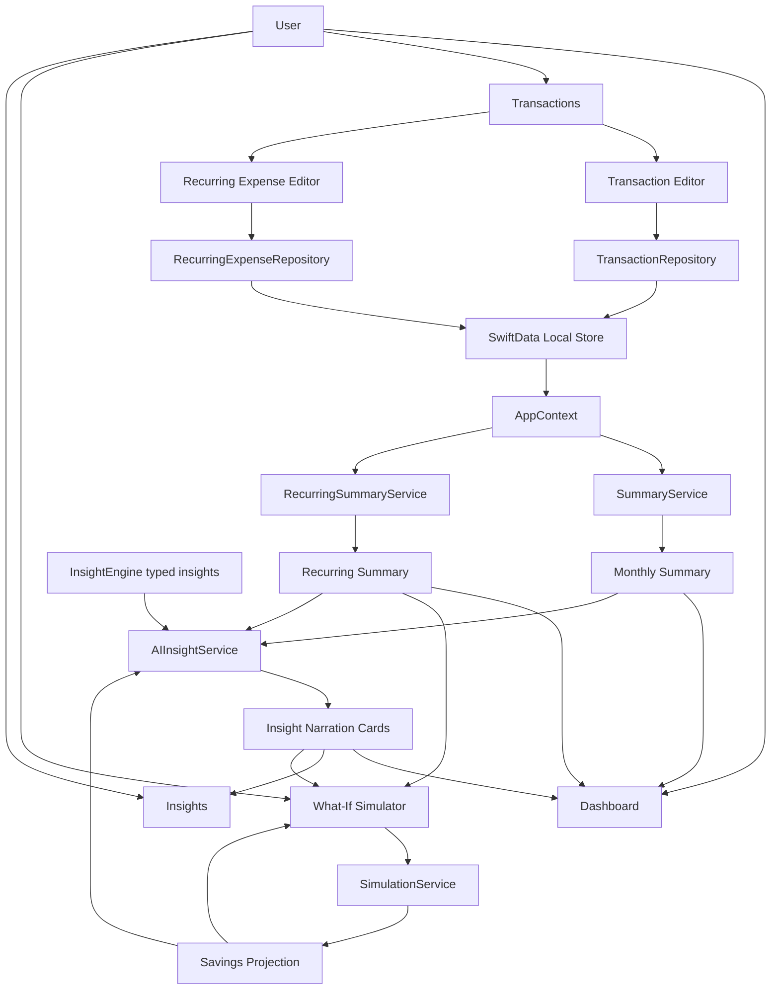

# FinSight AI

FinSight AI is an AI-first personal finance startup concept packaged as a local-first iOS app. The goal is to help people move from passive expense logging to active financial decision-making through clear spending visibility, personalized insights, and scenario-based planning.

## Vision

Most finance apps show users what already happened. FinSight AI is designed to help users understand what it means and what to do next.

The product focuses on three core outcomes:

- expense tracking
- behavioral spending insight
- forward-looking financial simulation

The long-term startup direction is a financial decision assistant that feels more like an intelligent money coach than a ledger.

## Product Thesis

FinSight AI is built around a simple thesis:

- users do not just want records
- users want interpretation
- users want realistic next steps

The app is intended to surface:

- where money is going
- what habits may be risky
- what improvements are realistic
- how small changes compound over time

## Current MVP

The current version is a fully local v1 MVP. It uses SwiftData for persistence and is structured to support Apple Intelligence as the long-term on-device AI layer.

## Features

### Onboarding (Phase 7)

- first-run setup in six steps: name and role (optional), region, currency and first weekday, monthly income, one to three savings goals, opt-in sample data and local reminders (both off by default), and how the private on-device AI works
- nothing is saved until **Start my plan**; the income, goals and settings are committed in one save
- people who already have data skip onboarding

### Dashboard

- Android-style greeting: "Welcome back, *name*", the role, an initials avatar and the theme chip
- month picker for the spending total, category breakdown and recent activity
- six-month spending trend (`BarMark`) with the selected month highlighted
- Forward Simulator quick action and a "View All" link to Insights
- category breakdown chart
- recent transaction snapshot
- AI insight card state

### Themes, accessibility and languages (Phase 7)

- the Android app's three palettes, **Deck Emerald** (default), **Cyber Slate** and **Midnight Blue**, chosen from the dashboard chip or Settings. Each palette has a light and a dark variant that follow the iPhone's appearance, and a unit test checks WCAG contrast for each one
- VoiceOver: cards are grouped into single elements, every chart has an `accessibilityChartDescriptor` (audio graphs), and icon-only buttons have labels
- Dynamic Type: no fixed font sizes; chart heights and icon sizes use `@ScaledMetric`
- Reduce Motion turns off loading shimmer, typing dots and number animations
- haptics for tab and month changes, saves, onboarding completion and errors
- English and Filipino (`fil`) via `FinSightAI/Localizable.xcstrings`. Insight-engine sentences, AI narration and prompts stay in English for now, so the figures they quote stay grounded

### Transactions

- add transactions
- edit transactions
- delete transactions
- grouped monthly history
- natural-language quick add ("coffee 150 yesterday") that fills the new-transaction form; the amount and date are always read by code, never by the model
- automatic category suggestions from the merchant or note (keyword rules first, then the on-device model), labelled by source and never overriding a category you picked
- clean-up of bank-style merchant names ("SQ *BLUE BOTTLE COFFEE #1234" → "Blue Bottle Coffee")

### Planning (Phase 2)

- income sources and a "% of income spent / buffer remaining" gauge
- per-category monthly budgets with progress bars and a Swift Charts target line
- savings goals with progress, months-to-reach and a "funded by" estimate
- category filter chips and merchant search on Transactions
- CSV export (RFC 4180) via the Settings tab, plus currency, first weekday and opt-in sample data

### Insights

A deterministic, on-device `InsightEngine` analyses the last 12 months and produces typed insights (kind, severity, impact amount, evidence, suggested action). It needs no AI and works on every device:

- budget breach and projected overrun (run rate × days left)
- month-over-month category change
- category and merchant anomalies (robust z-score against the trailing 3-6 month median/MAD)
- auto-detected recurring charges and subscriptions, with price-creep detection
- savings rate, emergency-fund runway and no-spend streaks

Insights show as cards with severity badges and impact numbers, and can be dismissed or snoozed (persisted). The Foundation Models budgeting, risk and growth cards remain as optional narration below them.

### Simulator (Phase 5)

- a baseline of a typical full month, per category: the last 30 days of spending (scaled up only when your history is shorter than that), with recurring charges added once and with transfers, income, savings and one-off purchases left out
- a cut slider for each of your own categories (applied to everyday spending), a daily savings amount, and switches to pause recurring charges
- savings that compound monthly as `(balance + deposit) × (1 + APY / 12)`, with a configurable yield, an optional starting balance and a 12 to 60 month timeline
- a Swift Charts projection with 3, 6 and 12 month markers, a "goal reached" line for each unfinished savings goal at the balance that covers what it still needs, and an optional likely range drawn from how much your everyday spending has varied month to month
- a goals countdown: how many months each goal takes at its current pace and with the scenario, and whether that meets its target date
- named scenarios you can save, load and compare side by side
- a plan summary written by code, plus an AI explanation from one structured session that is grounded in the same figures

## Why It Matters

FinSight AI is aimed at a user segment that is underserved by traditional budgeting apps:

- people who want simple financial clarity without spreadsheet-heavy workflows
- users who need motivation through insight, not just raw numbers
- early-career earners and young professionals trying to build savings discipline

This makes the product suitable both as a consumer finance concept and as a startup portfolio case for intelligent financial UX.

## Tech Stack

- SwiftUI
- SwiftData
- Swift Charts
- Xcode project generated via Ruby and `xcodeproj`

## Architecture

The app is organized around protocol-backed services so the UI is not tightly coupled to storage or AI provider details.

Core components:

- `AppContext`: app-wide state and feature orchestration
- `TransactionRepository`: local CRUD and opt-in sample data
- `RecurringExpenseRepository`: user-managed recurring expense storage
- `SummaryService`: monthly aggregation and dashboard summary building
- `RecurringSummaryService`: recurring expense totals and transaction classification
- `SimulationService` / `ForwardSimulator`: pure `Decimal` what-if maths (run-rate baseline, compounding, goal countdowns, uncertainty band, scenario comparison)
- `AIInsightService`: AI abstraction for insights and simulator explanations
- `CapabilityService`: checks whether Apple Intelligence support is available



## Apple Intelligence

The codebase includes an abstraction layer for Apple Intelligence through `FoundationModels`.

Important note:

- the app targets iOS 26+, and the model's real availability (`SystemLanguageModel.default.availability`) is checked on every request
- when Apple Intelligence is unsupported, switched off, or still downloading, the app shows a specific, actionable message instead of fake AI output
- when the model is unavailable, the Dashboard and Insights screens fall back to the deterministic insights, and the Insights screen offers "Check Again" when the reason is recoverable
- the budgeting, risk and growth narration cards come from one session with `@Generable` structured output, streamed as they are written
- the prompt is grounded in the engine's typed insights and three months of history, trimmed to fit the model's context window
- the model can call tools (`categoryTotals`, `transactions(matching:)`, `budgetStatus`) so the figures it quotes are computed by code; narration that quotes amounts not found in the facts or tool results is retried once and then hidden
- the simulator's explanation uses the same structured session and availability fallback; every amount it quotes is checked against the scenario's facts, and the plan summary written by code is always shown beside it
- the model is prewarmed on launch, and narration is cached by a data fingerprint so unchanged data doesn't call the model again

The AI layer sits behind the `AIInsightService` protocol so other providers can be added later.

## Startup Direction

The current app is the foundation for a broader startup roadmap. Likely evolution paths include:

- personalized multi-agent financial coaching
- account aggregation and transaction import
- cloud sync and cross-device continuity
- longitudinal spending memory and behavior tracking
- proactive savings nudges and risk alerts
- subscription or premium coaching features

## Getting Started

### Requirements

- macOS
- Xcode 26 or newer (iOS 26 SDK)
- iOS 26+ simulator or device (Apple Intelligence features need a supported device)
- iOS Simulator

### Run In Xcode

1. Open `FinSightAI.xcodeproj`
2. Select the `FinSightAI` scheme
3. Choose an iPhone simulator such as `iPhone 17`
4. Press `Cmd+R`

A fresh install opens onboarding, and the ledger starts empty. To explore with example transactions, turn on **Load sample data** during onboarding or tap it on the Dashboard. Sample data is never added automatically.

### Build From Terminal

```bash
xcodebuild -project FinSightAI.xcodeproj -scheme FinSightAI -destination 'generic/platform=iOS Simulator' CODE_SIGNING_ALLOWED=NO build
```

### Run Tests

```bash
xcodebuild -project FinSightAI.xcodeproj -scheme FinSightAI -destination 'platform=iOS Simulator,name=iPhone 17' CODE_SIGNING_ALLOWED=NO test
```

## Project Structure

```text
FinSightAI/
  App/
  Design/
  Features/
    Dashboard/
    Insights/
    Onboarding/
    Planning/
    Settings/
    Shared/
    Simulator/
    Transactions/
  Models/
  Services/
  Utils/
FinSightAITests/
FinSightWidgets/
Tools/
```

## Testing

Automated coverage currently includes:

- transaction validation
- monthly summary aggregation
- forward-simulator maths: the Android simulator's seven tests as behavioural specs, `(b + d)(1 + r/12)` compounding, goal countdowns, the run-rate baseline's one-off and transfer exclusions, the uncertainty band's bounds, and saved-scenario comparison
- locale-aware currency formatting and amount parsing
- app-context save flow
- exact Decimal money storage and transaction kinds (expense, income, transfer)
- budgets, income sources, savings goals, and app settings
- app-level dedupe in place of `.unique` constraints
- V1 to V2 schema migration from an unversioned V1 store fixture
- budget progress and rollover, the income gauge, and savings-goal projections
- category chips and merchant search filtering
- RFC 4180 CSV export, including formula-injection neutralisation of free-text cells
- the deterministic insight engine: budget breaches and overruns, month-over-month changes, anomalies, recurring-charge and price-creep detection, savings rate, emergency-fund runway and no-spend streaks
- persisted insight dismiss/snooze and the V2 to V3 schema migration
- saved what-if scenarios and the V3 to V4 schema migration
- AI availability reasons and fallbacks, prompt grounding and token budgeting, figure grounding, the ledger tools, merchant-name cleaning, auto-categorization and quick-add parsing
- widgets, intents and reminders: budget 80%/100% thresholds, recurring due dates and the weekly digest, amount-free notification text, the pending-request cap, App Group store migration, the shared snapshot, intent input validation and the Add Expense control
- onboarding: draft validation (positive income, 1–3 named goals), a single atomic save, opt-in sample data, the profile, and skipping for existing users
- the three theme palettes: Android identifiers, fallback, and WCAG contrast in light and dark
- six-month trend totals and the month picker's range
- localization: every catalog key has a translated Filipino string with matching format specifiers, the app bundle ships `fil`, and English plurals read naturally
- on-device model smoke tests (`OnDeviceModelSmokeTests`) that run the real Foundation Models paths and skip, with the reason, where Apple Intelligence is unavailable

Manual smoke checks:

- on a fresh install, complete onboarding and confirm income, goals and settings appear; with **Load sample data** on, example transactions appear too
- switch themes from the dashboard chip and check light and dark appearance
- run with the device language set to Filipino, and with large Dynamic Type and VoiceOver
- confirm **Load sample data** in Settings populates an empty ledger
- add, edit, and delete transactions
- verify dashboard totals update after changes
- move simulator sliders and verify projections update instantly
- confirm the insights screen handles AI availability cleanly

## Roadmap

Potential next steps:

- Supabase auth and sync
- CSV import
- richer Apple Intelligence prompt flows
- server-backed AI orchestration
- offline-first sync and reconciliation
- retention flows
- premium insight packaging

## Project Generation

The Xcode project is generated with:

- `Tools/generate_project.rb`

To regenerate:

```bash
ruby Tools/generate_project.rb
```

## Widgets and local reminders

The `FinSightWidgets` extension includes small/medium spending widgets, Lock Screen accessories,
and an Add Expense control for Control Center and the Action button. `LogExpenseIntent` and
`SpendThisMonthIntent` are exposed as App Shortcuts for Siri, Shortcuts and Spotlight. Reads and
writes require device authentication. The control opens the expense editor for confirmation.

Both targets declare `group.com.finsightai.app`. Once a signing team is available, register that
App Group for both bundle IDs (`com.finsightai.app` and `com.finsightai.app.widgets`) and enable it
in both provisioning profiles. The app copies its original SwiftData store and SQLite sidecars to
an App Group store before extensions can read it; it preserves the original. CloudKit remains
disabled. An unsigned simulator build uses the app's own store if the shared container is
unavailable. An extension without App Group access shows an unavailable state instead of opening
an independent ledger; real sharing and Siri/Control Center device behavior need signed-device QA.

Enable reminders explicitly in Settings. Recurring definitions and P3 recurring detection supply
due dates, budget progress supplies 80% and 100% alerts, and P3 insights supply the weekly digest.
Notification titles and bodies never include amounts or spending totals, so Lock Screen previews
stay private; the figures appear only after opening the app. Paused manual bills override detected
subscriptions. All scheduling is local. The app refreshes on activation and after edits;
`BGAppRefreshTask` requests periodic refresh, subject to iOS scheduling. The weekly digest's insight
count reflects the last refresh, not a guaranteed Monday background execution. Notification
permission can be revoked in iOS Settings. There is no server or push registration.

The unsigned [terminal build and test commands](#build-from-terminal) cover both targets.

## Status

This repository represents an MVP for a startup-style product direction. It is meant to demonstrate product thinking, architecture, UX direction, and technical feasibility rather than full production readiness.
